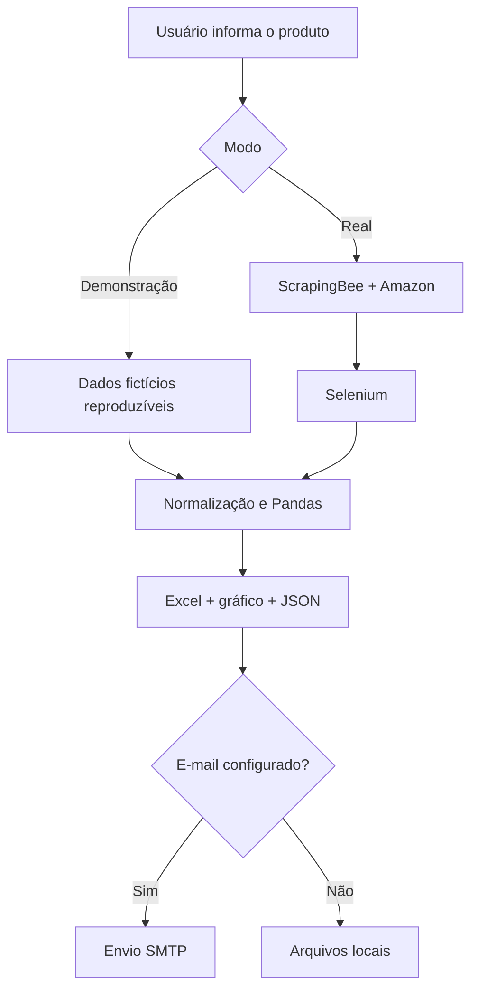
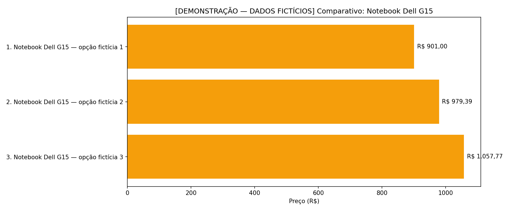

# Smart Price Compare — Automação RPA com Python

Aplicação desktop e CLI para pesquisar produtos, coletar preços e avaliações, organizar os dados e gerar relatórios comparativos. O projeto demonstra um fluxo de **RPA em Python** com automação de navegador, consumo de API REST, tratamento de dados e envio opcional por e-mail.

O repositório possui dois modos:

- **Demonstração:** executa todo o pipeline com dados fictícios e reproduzíveis, sem consumir API, abrir navegador ou enviar e-mail.
- **Real:** usa a ScrapingBee para descobrir links na Amazon Brasil e o Selenium para coletar as informações nas páginas dos produtos.

> Os dados do modo demonstração não representam ofertas reais. Confirme preços e disponibilidade diretamente na loja antes de comprar.

## Visão geral

Comparar manualmente vários produtos exige abrir páginas, copiar preços, organizar links e montar uma visualização. O Smart Price Compare automatiza esse processo e entrega:

- planilha Excel ordenada pelo menor preço;
- gráfico comparativo interativo em HTML, com rótulos compactos e título completo ao passar o mouse;
- resumo estruturado em JSON;
- envio opcional dos arquivos por SMTP.

## Arquitetura



## Tecnologias

| Tecnologia | Papel no projeto |
| --- | --- |
| Python 3.11+ | CLI, regras do fluxo, tratamento de erros e SMTP |
| Flet | Interface desktop |
| ScrapingBee API | Renderização da página de busca no modo real |
| Beautiful Soup | Descoberta e filtragem de links de produtos |
| Selenium | Automação do Chrome e extração nas páginas |
| Pandas + OpenPyXL | Organização e exportação para Excel |
| Plotly | Gráfico comparativo interativo |
| unittest | Testes automatizados sem dependências externas |

## Funcionalidades implementadas

- Execução por interface gráfica ou terminal.
- Modo de demonstração para validar o pipeline sem credenciais.
- Coleta real separada e explicitamente habilitada pelo usuário.
- Deduplicação de produtos pelo ASIN e filtragem básica de acessórios.
- Conversão de preços no padrão brasileiro, como `R$ 4.299,90`.
- Registro único por produto, evitando colunas com tamanhos diferentes.
- Uma pasta exclusiva por execução, separando `saida/demo/` de `saida/real/`.
- Identificação de modo e origem dentro do Excel, do gráfico e do JSON.
- Envio opcional por e-mail, com credenciais fora do código.
- Mensagens claras para falta de configuração, ausência de resultados e falhas externas.
- Encerramento garantido do navegador, mesmo quando ocorre erro.

## Estrutura do projeto

```text
comparativoPreco/
├── AutomateWeb.py             # pipeline, CLI, relatórios e e-mail
├── AutomateWebInterface.py    # entrada compatível que reutiliza o pipeline
├── interface.py               # interface Flet
├── TesteAutomate.ipynb        # demonstração guiada em notebook
├── tests/
│   └── test_automate_web.py   # testes unitários e de integração local
├── .env.example               # modelo de configuração, sem segredos
├── .gitignore
├── requirements.txt
└── README.md
```

## Instalação

Pré-requisitos:

- Python 3.11 ou superior;
- Google Chrome atualizado para o modo real;
- conta e chave da ScrapingBee apenas para coleta real.

```bash
git clone https://github.com/vinijr01/comparativoPreco.git
cd comparativoPreco

python -m venv .venv
```

Ative o ambiente virtual:

```bash
# Windows (PowerShell)
.venv\Scripts\Activate.ps1

# Linux/macOS
source .venv/bin/activate
```

Instale as dependências:

```bash
python -m pip install --upgrade pip
pip install -r requirements.txt
```

## Configuração

O modo demonstração não precisa de configuração. Para usar a coleta real ou o envio por e-mail, copie o arquivo de exemplo:

```bash
# Windows
copy .env.example .env

# Linux/macOS
cp .env.example .env
```

Preencha somente no arquivo `.env` local:

```dotenv
SCRAPINGBEE_API_KEY=sua_chave
SMTP_HOST=smtp.gmail.com
SMTP_PORT=587
SMTP_USER=seu_email@gmail.com
SMTP_PASSWORD=sua_senha_de_aplicativo
SMTP_USE_TLS=true
```

O `.env` é ignorado pelo Git. No Gmail, use uma **senha de app**; não coloque a senha normal da conta no projeto.

Para configurar o envio pelo Gmail:

1. Ative a **verificação em duas etapas** na Conta do Google.
2. Abra [Senhas de app](https://myaccount.google.com/apppasswords), crie uma senha para `Smart Price Compare` e copie o código de 16 caracteres.
3. Em `SMTP_USER`, coloque o endereço Gmail completo que enviará os arquivos.
4. Em `SMTP_PASSWORD`, cole a senha de app sem espaços. O e-mail digitado na interface é apenas o destinatário.

Se a opção de senha de app não aparecer, a conta pode ser corporativa/escolar, usar somente chaves de segurança na verificação em duas etapas ou estar inscrita na Proteção Avançada. Consulte a [orientação oficial do Google](https://support.google.com/accounts/answer/185833?hl=pt-BR).

> `.env.example` é apenas o modelo público e não é lido pela aplicação. Os valores reais devem ficar no arquivo chamado exatamente `.env`, ao lado de `AutomateWeb.py`.

> Quando um destinatário é informado, o SMTP é validado antes do início da coleta. Se a autenticação ou o envio falhar depois da coleta, os relatórios locais continuam disponíveis e a interface informa a falha separadamente.

## Execução

### Interface gráfica

```bash
python interface.py
```

A interface inicia em demonstração e exibe um aviso amarelo de dados fictícios. Ao selecionar `REAL`, o aviso fica verde, a origem passa a ser Amazon Brasil e o resultado exibido na própria interface mostra nomes, preços, links e os caminhos exatos daquela execução.

### Terminal — demonstração reproduzível

```bash
python AutomateWeb.py "notebook para trabalho" --modo demo --limite 5
```

### Terminal — coleta real

```bash
python AutomateWeb.py "Samsung S24" --modo real --limite 5
```

`--limite 1` coleta somente um produto; use `--limite 5` para solicitar até cinco resultados válidos.

Para acompanhar o Chrome durante a coleta:

```bash
python AutomateWeb.py "Samsung S24" --modo real --mostrar-navegador
```

Para também enviar os anexos por e-mail:

```bash
python AutomateWeb.py "Samsung S24" --modo real --email destino@exemplo.com
```

Antes de combinar e-mail com coleta real, valide o SMTP sem gastar créditos:

```bash
python AutomateWeb.py "teste de e-mail" --modo demo --limite 1 --email seu_email@gmail.com
```

Se aparecer `E-mail enviado`, a conta remetente está pronta. O remetente e o destinatário podem ser o mesmo endereço.

Use `python AutomateWeb.py --help` para ver todas as opções.

## Saída e rastreabilidade

Cada execução bem-sucedida cria uma pasta nova. Dados demo e reais nunca compartilham os mesmos arquivos:

```text
saida/
├── demo/
│   └── 20261015_001500_123456/
│       ├── comparativo_demo.xlsx
│       ├── grafico_demo.html
│       └── resumo_execucao.json
└── real/
    └── 20261015_002000_654321/
        ├── comparativo_real.xlsx
        ├── grafico_real.html
        └── resumo_execucao.json
```

O terminal e a interface informam claramente `DEMONSTRAÇÃO — DADOS FICTÍCIOS` ou `COLETA REAL — AMAZON BRASIL` e mostram uma prévia dos produtos coletados. O Excel possui as abas `Resultados` e `Execução`; a segunda registra modo, origem, consulta e horário.

No gráfico, os nomes aparecem abreviados para preservar o layout. Passe o mouse sobre uma barra para ver o título completo, o preço, a avaliação e a origem. Os títulos sem corte permanecem no Excel e no JSON.

Se Plotly não estiver disponível, o programa gera o gráfico em PNG com Matplotlib como alternativa.

## Demonstração

Exemplo produzido pelo próprio modo demonstração, com cinco registros fictícios:



Esse modo percorre a mesma etapa de normalização e geração de relatórios do fluxo real. A diferença está somente na origem dos dados, permitindo avaliar o projeto sem credenciais ou dependência de sites externos.

## Testes

Os testes não acessam Amazon, ScrapingBee ou SMTP:

```bash
python -m unittest discover -s tests -v
```

Eles verificam a conversão de preços, a filtragem, os rótulos do gráfico, a validação SMTP, os metadados dos relatórios e garantem que o modo real não possa cair silenciosamente no gerador de demonstração.

## Notebook

`TesteAutomate.ipynb` é uma apresentação executável do projeto. Ele foi reconstruído como JSON válido e utiliza as mesmas funções de `AutomateWeb.py`, evitando manter uma segunda cópia da regra de negócio.

No VS Code, selecione o interpretador do ambiente `.venv` e execute as células em ordem.

## Limitações

- A estrutura de páginas de e-commerce pode mudar sem aviso e exigir atualização dos seletores.
- Amazon e outros sites podem bloquear ou limitar automações; o projeto não tenta contornar CAPTCHA ou controles de acesso.
- O modo real depende da disponibilidade e dos limites da ScrapingBee, da Amazon, do Chrome e do SMTP.
- Preço e avaliação refletem o momento da coleta e podem variar por região, conta ou forma de pagamento.
- Esta versão consulta uma única loja. O modo demonstração existe para que recrutadores avaliem o pipeline sem gastar créditos ou depender desses serviços.

## Melhorias futuras

- Adaptadores para outras lojas, sem misturar regras específicas no pipeline.
- Mocks dos serviços externos e testes automatizados do modo real.
- Monitoramento, logs estruturados e tentativas com espera progressiva.
- Histórico de preços em banco de dados e alertas de queda.
- Empacotamento da interface para distribuição desktop.

## Segurança

O projeto não requer `dadosPrivados.py`. Chaves de API e dados SMTP são lidos do ambiente ou do `.env`, que não deve ser versionado. Se alguma credencial já tiver sido publicada em um commit anterior, removê-la do arquivo atual não é suficiente: revogue-a, gere outra e considere limpar o histórico do repositório.

## Autor

Desenvolvido por **Carlos Vinícius dos Santos Domingos**.

[LinkedIn](https://www.linkedin.com/in/vin%C3%ADcius-domingos-12a50b325/) · [GitHub](https://github.com/vinijr01)
